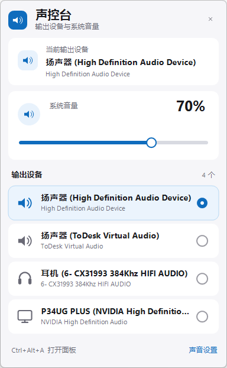
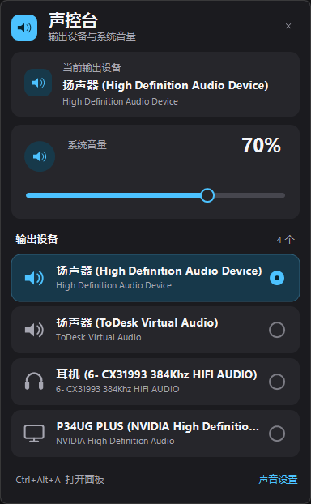

# AudioDeck

[](LICENSE)
[](https://github.com/zgyhbcz/AudioDeck/actions/workflows/build.yml)
[](#requirements)
[](https://dotnet.microsoft.com/download/dotnet-framework)
[](https://github.com/zgyhbcz/AudioDeck/releases)

**English** | [简体中文](README.md)

A tiny Windows 11 tray app for switching audio output devices and controlling the system volume from one popup.

> Windows 11 does not expose a public deskband API for third-party taskbar buttons, so AudioDeck uses a notification-area icon. The installer attempts to keep that icon visible on the taskbar.



## Features

- **One click**: click the blue speaker icon to open the audio panel.
- **Switch output devices**: lists all active render endpoints; click one to make it the default.
- Sets the default for console, multimedia, and communications roles so applications follow the change.
- **Master volume**: drag the slider or click anywhere on the track; mute/unmute with one click.
- **System-style feedback sounds**: a short Windows UI sound while changing volume and the current Windows "Device connect" sound after switching outputs.
- **Mouse wheel**: adjust volume or scroll a long device list.
- **Live updates**: headphones, displays, and Bluetooth devices are picked up as they are plugged in or removed.
- **Global hotkey**: `Ctrl+Alt+A`.
- **Light and dark themes**: follows the Windows app theme.
- **Auto-start**: enabled by default by the installer and toggleable from the tray menu.
- **Single instance**: launching it again opens the existing panel.
- No network access, no administrator rights, no third-party runtime (uses the built-in .NET Framework 4.8).



## Requirements

- Windows 10 1809 or later; Windows 11 is recommended.
- x64.
- .NET Framework 4.8 (included with Windows 11).

## Install

Download `AudioDeck-<version>.zip` from [Releases](https://github.com/zgyhbcz/AudioDeck/releases/latest), extract it, then run:

```powershell
powershell -NoProfile -ExecutionPolicy Bypass -File .\install.ps1
```

The installer copies the app to `%LOCALAPPDATA%\Programs\AudioDeck`, creates a Start menu shortcut, enables auto-start, registers an uninstall entry, and starts the app. It does not require administrator rights.

If the icon is hidden in the `^` overflow area, drag it onto the taskbar or enable it under **Settings > Personalization > Taskbar > Other system tray icons**.

## Usage

- **Left-click** the tray icon to open or close the panel.
- **Click a device** to switch the default output.
- **Drag the volume track** or click a position to set the master volume.
- **Mute button** toggles mute; adjusting the volume while muted unmutes.
- **Right-click** the tray icon for sound settings, auto-start, and exit.
- Press **Esc** or click outside to dismiss the panel.

## Uninstall

Use **Settings > Apps > Installed apps > AudioDeck**, or run:

```powershell
powershell -NoProfile -ExecutionPolicy Bypass -File "$env:LOCALAPPDATA\Programs\AudioDeck\uninstall.ps1"
```

## Build from source

The build uses the .NET Framework 4.x compiler that ships with Windows. Visual Studio or the .NET SDK is not required.

```powershell
powershell -NoProfile -ExecutionPolicy Bypass -File .\build.ps1
```

Output: `dist\AudioDeck.exe`

The version lives in [VERSION](VERSION). It can be overridden:

```powershell
.\build.ps1 -Version 1.2.3
.\package.ps1 -Version 1.2.3
```

## How it works

- Device enumeration and volume control use the Windows Core Audio API
  (`IMMDeviceEnumerator`, `IAudioEndpointVolume`).
- Default endpoint switching uses the undocumented but long-standing
  `IPolicyConfig::SetDefaultEndpoint` interface.
- The popup is a borderless, per-monitor DPI-aware WinForms window with DWM rounded corners.
- Feedback sounds are played through WinMM `PlaySound` with `SND_SYSTEM`, so they use the
  Windows "System Sounds" session and the current sound scheme.

## Contributing

Issues and pull requests are welcome. Read [CONTRIBUTING.md](CONTRIBUTING.md) first.
For security reports, follow [SECURITY.md](SECURITY.md).

## License

[MIT](LICENSE) © 2026 zgyhbcz.

The `IPolicyConfig` declaration is based on DefSound's MIT-licensed `PolicyConfig.h`.
See [THIRD_PARTY_NOTICES.md](THIRD_PARTY_NOTICES.md).
