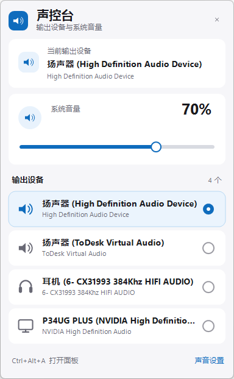
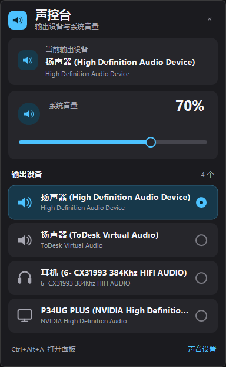

# 声控台 AudioDeck

[](LICENSE)
[](https://github.com/zgyhbcz/AudioDeck/actions/workflows/build.yml)
[](#系统要求)
[](https://dotnet.microsoft.com/download/dotnet-framework)
[](https://github.com/zgyhbcz/AudioDeck/releases)

[English](README.en.md) | **简体中文**

Windows 11 任务栏小插件：单击托盘里的蓝色扬声器图标，就能在一个面板里切换音频输出设备、调节系统总音量。

> Windows 11 没有向第三方开放“把按钮嵌进任务栏”的公开接口，所以本程序使用任务栏右下角的系统托盘图标实现同样的一键操作。图标可以像其他托盘程序一样显示在任务栏上。



## 功能

- **一键打开**：单击托盘图标，立即弹出设备与音量面板。
- **切换输出设备**：列出当前所有可用的播放设备，单击即可设为默认输出。
- 切换时会同时设置 Windows 的“默认设备”“默认多媒体设备”和“默认通信设备”，避免不同程序仍走旧设备。
- **系统总音量**：拖动滑块调节主音量，单击左侧按钮静音/取消静音。
- **操作提示音**：调节音量时播放与系统一致的短提示音；切换设备时播放 Windows 当前的“设备连接”提示音。两种声音都走系统声音通道，可在音量合成器里调整“系统声音”音量。
- **滚轮调节**：鼠标指针在面板内时，滚轮也能调节音量；设备多时可滚动设备列表。
- **自动刷新**：插拔耳机、显示器或蓝牙设备后，面板与托盘提示自动更新。
- **全局快捷键**：`Ctrl+Alt+A` 随时开关面板。
- **深浅色自适应**：跟随 Windows 的应用主题。
- **开机自动启动**：安装时默认启用，可在托盘右键菜单中随时关闭。
- **单实例**：重复运行只会打开已有面板，不会启动多份。
- 无网络访问、无管理员权限要求、无第三方运行库（使用系统自带的 .NET Framework 4.8）。



## 系统要求

- Windows 10 1809 或更高版本；Windows 11 获得最佳视觉和托盘行为。
- x64 系统。
- .NET Framework 4.8（Windows 11 已内置）。

## 下载与安装

从 [Releases](https://github.com/zgyhbcz/AudioDeck/releases/latest) 下载 `AudioDeck-<version>.zip`，解压后执行：

```powershell
powershell -NoProfile -ExecutionPolicy Bypass -File .\install.ps1
```

也可以右键 `install.ps1`，选择“使用 PowerShell 运行”。如果系统执行策略阻止运行，请使用上面的命令。

安装脚本会把程序复制到：

```text
%LOCALAPPDATA%\Programs\AudioDeck
```

并创建开始菜单快捷方式、开机启动项和“应用和功能”中的卸载入口。全程不需要管理员权限。安装完成后会把托盘图标设置为显示在任务栏上；如果 Windows 仍然把它收进 `^`，按下面步骤拖出来即可。

### 如果看不到托盘图标

Windows 11 可能会把新托盘图标收进 `^` 溢出区：

- 点击任务栏的 `^`，把蓝色的“声控台”图标拖到任务栏上；或
- 打开 **设置 > 个性化 > 任务栏 > 其他系统托盘图标**，把“声控台”设为“开”。

想把入口也固定到任务栏：在开始菜单找到“声控台”，右键 > 更多 > 固定到任务栏。固定后单击任务栏图标同样可以打开面板。

## 使用

- **左键单击托盘图标**：打开/关闭面板。
- **点击设备行**：切换默认输出设备。
- **拖动音量条**：调节系统总音量；点击音量条任意位置可直接跳转。
- **点击静音按钮**：静音/取消静音。静音时拖动音量条会自动取消静音。
- **点击“声音设置”**：打开 Windows 自带的声音设置。
- **右键托盘图标**：
  - 打开控制面板
  - Windows 声音设置
  - 更多声音设置（传统 mmsys.cpl）
  - 开机自动启动（勾选/取消）
  - 退出声控台
- **快捷键**：`Ctrl+Alt+A`。如果该快捷键被其他程序占用，程序会自动忽略，托盘菜单仍可正常使用。
- **单击面板外或按 Esc**：关闭面板。

## 卸载

任选一种：

- **设置 > 应用 > 已安装的应用**，找到“声控台 AudioDeck”并卸载；或
- 运行安装目录里的 `uninstall.ps1`：

```powershell
powershell -NoProfile -ExecutionPolicy Bypass -File "$env:LOCALAPPDATA\Programs\AudioDeck\uninstall.ps1"
```

卸载会停止程序、移除开机启动项、开始菜单快捷方式和安装目录。

## 文件说明

```text
AudioDeck.exe              主程序
AudioDeck.exe.config       .NET 4.8 / DPI 配置
install.ps1                安装脚本
uninstall.ps1              卸载脚本
README.md / README.en.md   中文 / 英文说明
LICENSE                    MIT 许可证
THIRD_PARTY_NOTICES.md     第三方代码声明
CHANGELOG.md               版本变更记录
previews\                  界面预览图
```

## 从源码构建

需要 Windows 自带的 .NET Framework 4.x 编译器（`csc.exe`），不需要安装 Visual Studio 或 .NET SDK。

```powershell
powershell -NoProfile -ExecutionPolicy Bypass -File .\build.ps1
```

输出：`dist\AudioDeck.exe`

版本号统一写在根目录的 `VERSION` 文件中。也可以在构建时覆盖：

```powershell
.\build.ps1 -Version 1.2.3
.\package.ps1 -Version 1.2.3
```

源码结构：

```text
src\Program.cs                    入口、单实例、异常日志
src\TrayContext.cs                托盘图标、右键菜单、快捷键
src\SoundFeedback.cs              音量/设备切换的系统提示音
src\Audio\CoreAudioInterop.cs     Core Audio COM 接口
src\Audio\AudioManager.cs         设备枚举、默认设备切换、音量
src\UI\PanelForm.cs               自绘弹出面板
src\UI\IconPainter.cs             图标与设备图形
src\UI\Theme.cs                   浅色/深色主题
src\UI\ThemedMenuRenderer.cs      右键菜单配色
```

技术要点：

- 设备枚举与音量控制使用 Windows Core Audio API（`IMMDeviceEnumerator`、`IAudioEndpointVolume`）。
- 默认设备切换使用 Windows 内部但长期稳定的 `IPolicyConfig::SetDefaultEndpoint`。
- 面板为无边框、Per-Monitor V2 DPI 感知的 WinForms 窗口，使用 DWM 圆角。
- 程序只写入以下用户级位置：
  - `HKCU\Software\Microsoft\Windows\CurrentVersion\Run`
  - `HKCU\Software\Microsoft\Windows\CurrentVersion\Uninstall\AudioDeck`
  - `%LOCALAPPDATA%\Programs\AudioDeck`
  - 开始菜单快捷方式

## 常见问题

**切换设备后某个程序还是从旧设备出声？**
少数程序会锁定自己的输出设备。请在程序内部的音频设置里重新选择“默认设备”，或重启该程序。系统级默认设备已经切换。

**为什么只显示“可用”的设备？**
面板只列出当前处于启用且已连接状态的播放设备，和 Windows 声音设置里的“输出”列表一致。已禁用或未插入的设备不会显示。

**支持 Windows 10 吗？**
核心功能支持 Windows 10 1809 及以上；界面按 Windows 11 设计。需要 .NET Framework 4.8。

**会收集数据吗？**
不会。程序不联网，不写日志（只有崩溃时才写 `%LOCALAPPDATA%\AudioDeck\error.log`）。

## 参与贡献

欢迎提交 Issue 和 Pull Request：

- [提交 Bug](https://github.com/zgyhbcz/AudioDeck/issues/new?template=bug_report.yml)
- [提出功能建议](https://github.com/zgyhbcz/AudioDeck/issues/new?template=feature_request.yml)
- 提交代码前请阅读 [CONTRIBUTING.md](CONTRIBUTING.md)
- 安全问题请按 [SECURITY.md](SECURITY.md) 私下报告

## 许可证

本项目使用 [MIT License](LICENSE) 开源。

切换默认设备使用的 `IPolicyConfig` COM 接口定义参考了 DefSound 的 MIT 许可代码，
详见 [THIRD_PARTY_NOTICES.md](THIRD_PARTY_NOTICES.md)。

## 版本

1.0.1（见 [CHANGELOG.md](CHANGELOG.md)）
